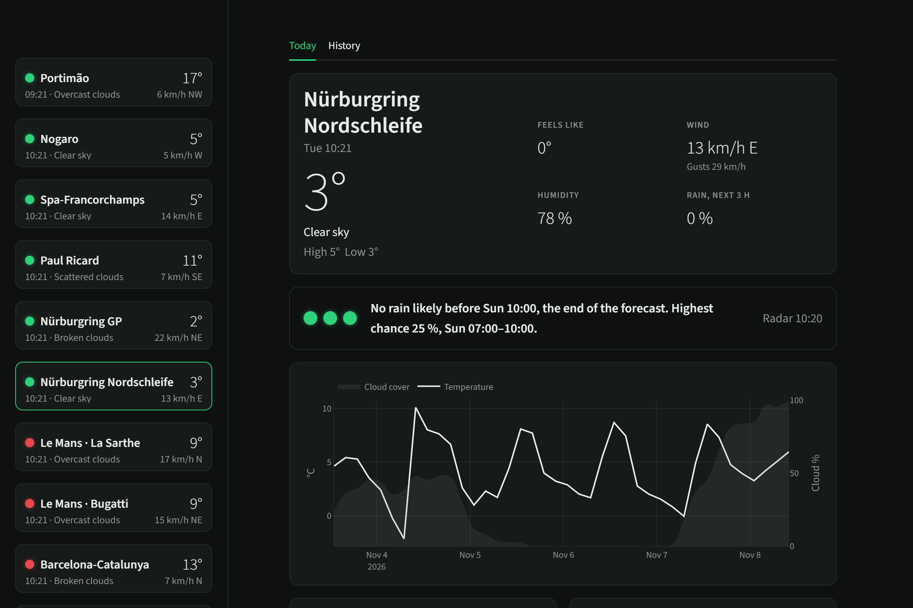
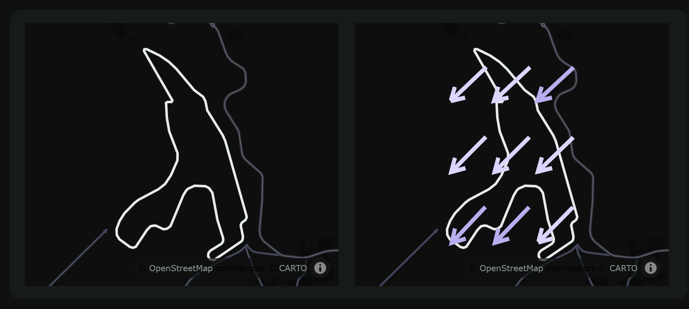
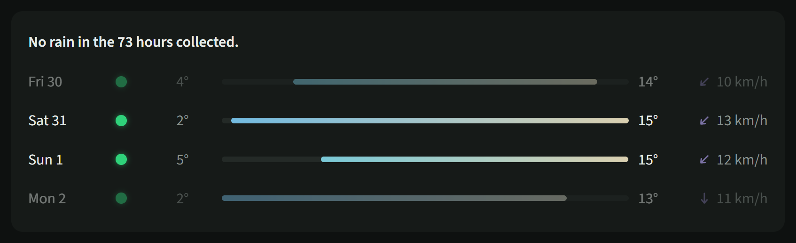

# Weather Insights

Python II group assignment: an object-oriented weather app built on OpenWeatherMap and Streamlit.

## Racetrack MVP

This branch turns the v0.1 weather app into a racetrack weather monitor. It is an MVP on purpose: one provider, a few things done properly, and features only get added once the existing ones work.

### Why

When you go to a circuit, whether you drive, work in a team or just watch, the questions are always the same: will it rain during my session, when, how much, and what is the wind doing. Stock weather apps answer for the nearest town, and mix today with everything else.

### What it does

One page per circuit about today (current conditions, temperature and cloud cover over the next days, rain radar and wind direction side by side, rain per forecast window with a one line "dry until…"), and a History tab built on our own readings, collected every 30 minutes for each circuit since 29 October 2026. Circuits come from a CSV, so adding one is a single line.

### Left out on purpose

- Circuit comparison.
- Track temperature, grip and tyre calls, which can't be estimated honestly from forecast data.
- Several providers and a settings pane to pick them (planned for a later version).
- Race calendar.

### Data limits

- The free OpenWeatherMap key only gives the forecast in 3 hour steps, so rain timing is per window, and the radar shows the latest image only. OpenWeatherMap's student plan has an hourly 4-day forecast, applying for it would give hourly steps.
- The wind map only shows speed, so the arrows are interpolated from current weather at a 3 by 3 grid of points around the track.
- One weather point per circuit can't catch rain falling on only part of a big track (Spa, the Nordschleife, Le Mans).

The rest of this README describes the app as it is now.

## What it does

**Track:** a dropdown at the top of the page picks one of the 18 circuits in `data/circuits.csv`. The choice is kept in the address (`?track=spa`), so a reload or a bookmark keeps it. Only that track is fetched.

**Sidebar, my sessions:** the sessions you add for the selected track, each with a status light (green dry, red rain likely, unlit beyond the forecast) and its highest chance of rain, by the same rule as the status lights. Tap a session to edit it in place (Save, Delete); its time shows as a block across the forecast charts. Add a session with the form, or fill the standard weekend with "Use default weekend" (FP1 and FP2 on Friday, FP3 and Qualifying on Saturday, the Race on Sunday, in track time). Sessions are saved in `data/sessions.csv`, which Git ignores.

**Today**, in three groups:
- Now: temperature, coloured by its value, a condition glyph and the conditions, local time, high and low, feels like, wind with gusts and humidity, then three status lights for now, the next 3 hours and later today, with one short line on when rain is likely.
- The next 5 days on one time axis, with a condition glyph above each day: temperature as a line coloured by its value, each day's high and low written on it, over a faint cloud-cover band; below it rain and snow per 3-hour window in mm, red only when rain is likely and neutral otherwise.
- Two maps side by side, stacked on a phone, both framed so the circuit's outline fills them: rain radar from RainViewer, and a 3 by 3 field of large wind arrows in one violet hue, brighter when stronger, interpolated from current weather at 9 points around the track.

**History**, from our own collected readings for the selected circuit, every 30 minutes since 29 October 2026: one row per collected day, like a weather app's daily forecast: a dot for rain (green dry, red with the hours of rain), the day's low and high with a bar between them on one shared scale coloured by temperature, and the average wind with an arrow for the direction it came from most often. A day with less than 20 hours of data, such as one cut by the collector's gap on 2 and 3 November, is muted, and one with less than 12 hours is not shown. One sentence above the rows says how much it rained. History works without an API key. Stuck readings (3 or more in a row with the same temperature, wind speed and direction, such as OpenWeatherMap's frozen 8.87 °C at Le Mans) count once in History; `data/current_weather.csv` keeps them all.

Colour carries data: one cool-to-warm scale for every temperature, with a step every 5° from periwinkle at -5° through sky and cyan to sand at 15° and orange at 30°, one violet scale for wind speed, green for dry and red for rain. Neither temperature nor wind uses green or red.

Each current-weather fetch for a circuit is added to `data/weather_log.csv` with a UTC timestamp. Readings are cached for 10 minutes, so ordinary page reruns do not add duplicate rows. Forecasts and the wind grid points are not logged.

## Screenshots

Taken from a test run at 1280 px, with invented forecast data and the real radar.





## Setup from a clean clone

Requires Python 3.11 or newer and [uv](https://docs.astral.sh/uv/).

```bash
git clone https://github.com/CaillouMalade/python-ii-weather-insights.git
cd python-ii-weather-insights
uv sync
```

Copy the example settings file. On Windows PowerShell:

```powershell
Copy-Item variables.env.example variables.env
```

On macOS/Linux:

```bash
cp variables.env.example variables.env
```

Then put your own OpenWeatherMap key in `variables.env`. Git ignores this file; never commit or display a real key. A free-tier key is enough.

Without a key, the app still opens: Today shows a setup message and History works on the collected data.

## Run the app

```bash
uv run streamlit run app.py
```

## Run the tests

```bash
uv run pytest
```

The tests use small hand-made cases with known answers, plus checks on the committed circuit list and history. They need no key and make no API calls.

## How the API key stays private

The key is only used on the server. The browser receives the radar as one finished image, stitched on the server with Pillow, and the wind as plain numbers for the arrows. RainViewer needs no key. The map background comes from CARTO's free basemap, which needs no token.

## The hardest parts to explain

For the team's walkthrough. Start with these, because they are the least obvious code in the project.

- **Radar framing (`src/weather_app/maps.py`):** a web map is a grid of square images. `lat_lon_to_tile` turns a place into a tile position, `radar_area` picks the tiles around the circuit and the square to keep, and `stitch_tiles` joins them. RainViewer's tiles stop at zoom 7, where a pixel is about 1 km, but the map is zoomed in much further, so `enlarge` stretches the square 16 times with smooth bicubic resampling.
- **Track outlines (`load_track` in `storage.py`, `track_view` and `track_layer` in `maps.py`):** each GeoJSON file becomes a list of line segments; OpenStreetMap ways stay separate, as in the file. `track_view` finds the zoom at which the outline's bounds fill a 340 by 320 pixel map with a small margin, on the map's own grid, where at zoom z the world is 512 × 2^z pixels across. The outline is drawn as map layers, a dark casing then a 3 px line, on both maps.
- **Wind field (`wind_field`, `interpolate_wind` and `wind_arrow` in `maps.py`):** OpenWeatherMap's wind map shows speed only, so the app asks for current weather at a 3 by 3 grid around the track. Each of the 25 arrows takes its value by bilinear interpolation of the four grid points around it. Directions cannot be averaged as numbers (350° and 10° would give 180°), so each wind is first split into east and north parts (`wind_vector`), interpolated, then turned back. Wind direction says where the wind comes from, so each arrow is drawn the opposite way.
- **3-hour windows (`src/weather_app/forecast.py`):** OpenWeatherMap gives each forecast step's rain as the amount in the 3 hours before its time, so each step is drawn as the window that ends at that time. `rain_timing` walks through the windows to find the first run with a chance of rain of at least 50 %.
- **History days (`hourly`, `daily` and `daily_rows` in `src/weather_app/history.py`):** `resample("h").mean()` makes one row for every hour, and an hour without readings gets no value, so counting the hours with a value tells how complete each day is; under 20 hours, the day is muted. Times are converted with each circuit's time zone name, so summer time is handled. Wind directions are counted as compass points, and the most frequent one gives the row's arrow. `drop_stuck` first keeps only the first reading of any stuck run.
- **Temperature colour (`temperature_color` in `src/weather_app/display.py`):** eight colour stops, every 5° from -5° to 30°; a temperature between two stops mixes their red, green and blue in proportion.
- **Logging inside the cache (`fetch_and_log_current` in `src/weather_app/fetching.py`):** Streamlit reruns the whole script on every click. The log is written inside the function decorated with `@st.cache_data`, so a rerun reuses the saved answer and adds no duplicate row.
- **Status lights (`status_lights` in `forecast.py`, `light` in `cards.py`):** each light is the rain-timing rule (a chance of rain of at least 50 %) applied to a slice of the windows: the one running now, those starting within 3 hours, and the rest of today. Each light also carries its meaning in words, for screen readers.
- **Sessions (`src/weather_app/sessions.py`):** a session overlaps every 3-hour window that starts before it ends and ends after it starts; its light is the status rule applied to those windows. `weekend_friday` picks the current weekend until Sunday's race has ended, then the next one.
- **Tappable rows (`src/weather_app/style.py`, `show_sessions` in `src/weather_app/views.py`):** a Streamlit button cannot contain a designed row. So each session row is plain HTML, and an invisible real button is stretched over it with CSS.

## Project structure

- `app.py`: the entry point.
- `src/weather_app/client.py`: `APIClient` (generic GET, with or without a key), `WeatherClient` (OpenWeatherMap) and `RainViewerClient` (radar).
- `src/weather_app/models.py`: `WeatherReading`.
- `src/weather_app/storage.py`: the circuit list, the collected history and the app's own log.
- `src/weather_app/forecast.py`: forecast windows, the rain-timing sentence and the status lights.
- `src/weather_app/history.py`: the collected history, its gaps and its findings.
- `src/weather_app/maps.py`: tile maths, the radar image, wind arrows and the two Plotly maps.
- `src/weather_app/fetching.py`: cached API calls.
- `src/weather_app/display.py`: small helpers for local time, wind direction and high and low.
- `src/weather_app/sessions.py`: my sessions, the default weekend and their rain status.
- `src/weather_app/icons.py`: the condition glyphs and the wind arrow, as SVG data URIs.
- `src/weather_app/views.py`, `cards.py`, `style.py`: the UI.
- `data/circuits.csv`: the circuits, each with its outline file. `straight_heading_deg` is blank for now and not used.
- `data/sessions.csv`: your own sessions, created when you add one. Git ignores it.
- `data/tracks/`: one GeoJSON outline per circuit, and the f1-circuits licence.
- `data/current_weather.csv`: a snapshot of the collected history, taken 3 November 2026.
- `data/weather_log.csv`: the app's own fetches.
- `tests/`: the tests.
- `PROMPTS.md`: the AI collaboration log.
- `assignment/BRIEF.md`, `summary.md` and `starter_template/`: the original assignment material.

## Data sources and credits

OpenStreetMap and CARTO are credited on each map, as their licences ask. The other sources are credited in one line at the foot of the page.

- Weather and forecasts: [OpenWeatherMap](https://openweathermap.org).
- Rain radar: [RainViewer](https://www.rainviewer.com/), whose API is for personal and educational use.
- Basemap: © [OpenStreetMap](https://www.openstreetmap.org/copyright) contributors © [CARTO](https://carto.com/attributions).
- Track outlines for Spa, the Nürburgring GP, Barcelona, Magny-Cours, Paul Ricard, Silverstone, Monza, Imola and Portimão: [f1-circuits](https://github.com/bacinger/f1-circuits) by Tomislav Bacinger, MIT licence (`data/tracks/LICENSE-f1-circuits.txt`).
- Track outlines for MotorLand Aragón, Dijon-Prenois, Estoril, Jarama, Jerez, Le Mans (both layouts), Nogaro and the Nordschleife: © [OpenStreetMap](https://www.openstreetmap.org/copyright) contributors, [ODbL](https://opendatacommons.org/licenses/odbl/).

## Team

Add group members and their actual contributions as work progresses.
