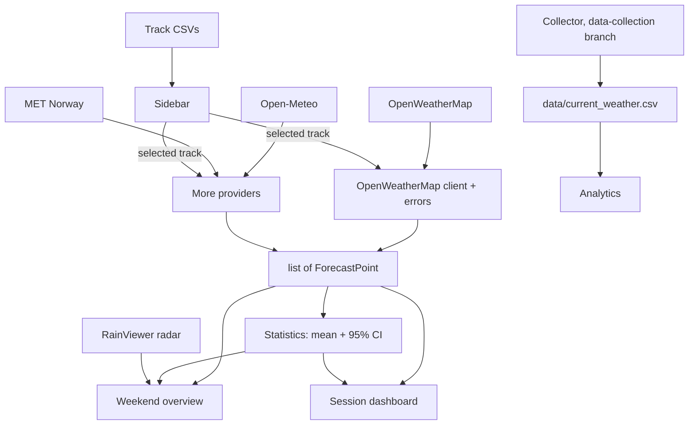

# Racetrack Weather (development)

Python II group assignment: an object-oriented Streamlit app for racetrack weather, built on OpenWeatherMap. This is the technical README for the `dev` branch: what we are building, how the code fits together, and the board of work. The user README for `main` is written at the end.

## Why this app

When racing on a track, weather plays a massive role, and three factors basically drive everything:

- **Temperature:** it has a big influence on how well we can use the tyres and on overheating, so if the temperature evolves quickly during a session it can completely change our strategy (for instance in qualifying, if we can see it gets colder later, it's in our best interest to wait for maximum performance).
- **Rain:** obviously it matters a massive amount, and having a precise idea of when it's going to rain is extremely important. The main issue we encounter is that the different weather apps on our phones or the radars often give conflicting information, and it's always difficult to compare them and to know which one to trust.
- **Wind:** the cars rely on aerodynamics, so wind in a certain direction in a corner can massively influence the car and even be a cause for errors, hence having an idea of the wind strength and direction is just as important.

Knowing that, the idea is a weather app that aggregates several APIs, so instead of giving one ungrounded likelihood of rain, we give the statistical likelihood of rain and wind with more detail, on top of the wind over the track map and the rain radar. It's an MVP (we will need more granularity later), but that's the main idea.

## How it works

Race weekends usually follow the same format and timing, so for now the session times are hardcoded, and being able to change the session hours comes later as polish. The app has four views:

1. **Weekend overview (main dashboard):** the mechanics need to prepare the car's setup a few days before, so we need the whole weekend at a glance. For instance, if we can see that tomorrow is going to rain, we need to test a few different setups, since the car is set up differently in the wet than for maximum performance in the dry.
2. **Session dashboard:** more granular, per-session information.
3. **History:** what usually happens on a given track, the temperature range and how variable things are over that particular circuit. That's a really important metric because it tells us how much we can trust the forecast there.
4. **Track comparison:** it's always interesting to compare different tracks over the same period and see how they differ rain-wise, temperature-wise and wind-wise (no track map needed here).

## What the app should do

A user can:
1. Pick a track from the list in the sidebar.
2. Add a track by typing a name, latitude and longitude. It is saved only if it lies within 3 km of an FIA Grade 1 circuit; otherwise the app says so.
3. See the weekend's session times (FP1, FP2, FP3, Qualifying, Race), fixed for now.
4. **Weekend overview:** see the weather now at that track (temperature, feels like, rain, wind strength and direction), the next 5 days on one chart (temperature °C, rain mm, wind km/h), and the rain radar on a map around the track.
5. **Session dashboard:** go through the sessions one by one and see, for each, the temperature, chance of rain and wind strength and direction during that session.
6. See how sure the forecast is: the average of three providers with a 95% confidence interval.
7. **History:** see what usually happens at a track, from our own logged data: rain, temperature range and how variable the weather is there.
8. **Track comparison:** compare two tracks over the same period, with a short summary of each (average temperature, rain days, total rain).
9. Get a clear message, never a crash, when the input is wrong, the key is bad, the network is down or a provider fails. The rest of the app keeps working.

Every successful fetch is logged with a timestamp to a CSV that grows over time and is committed with the repo.

Temperatures are air temperatures. Track (surface) temperature is measured by the race engineers on track and is not part of this MVP.

## Setup

Requires Python 3.11 or newer and [uv](https://docs.astral.sh/uv/).

```bash
git clone https://github.com/CaillouMalade/python-ii-weather-insights.git
cd python-ii-weather-insights
git switch dev
uv sync
cp variables.env.example variables.env        # Windows PowerShell: Copy-Item variables.env.example variables.env
```

Put your own OpenWeatherMap key in `variables.env`. Git ignores this file; never commit a key.

```bash
uv run streamlit run app.py     # run the app
uv run pytest                   # run the tests (no key, no API calls)
```

## How the code fits together



Current modules in `src/weather_app/`: `client.py` (API classes and input checks), `models.py` (data classes), `fetching.py` (fetch, log, skip failures), `storage.py` (CSV files), `analytics.py` (analyses on the log), `config.py` (loads the key). Put new code where it fits; we tidy the layout in the refactor at the end.

### Shared data (do not change without telling everyone)

- **`ForecastPoint`** (`models.py`): one provider's forecast for one 3-hour window: `source`, `time_utc` (window start, UTC), `temperature` (°C), `wind_speed` (m/s), `wind_deg`, `rain` (mm over the window). Missing values are `None`. Every provider returns a list of these on the same windows. `tests/fake_forecast.py` has an invented three-provider forecast to build against.
- **`WeatherReading`** (`models.py`): current conditions at one place.
- **Log** `data/current_weather.csv`, written by the collector: `fetched_at_utc, observed_at_utc, location_id, location_name, latitude_deg, longitude_deg, provider_latitude_deg, provider_longitude_deg, temperature_c, feels_like_c, humidity_pct, pressure_hpa, wind_speed_m_s, wind_direction_deg, wind_gust_m_s, cloud_cover_pct, visibility_m, rain_1h_mm, snow_1h_mm, weather_code, weather_description`.
- **Tracks:** `data/circuits.csv` (the list in the app), `data/grade1_tracks.csv` (`id, name, country, latitude, longitude`: the FIA Grade 1 circuits used to check an added track), `data/my_tracks.csv` (tracks users add).

## How we work

- Take a card from the board, work on your own branch from `dev`, and open a pull request into `dev`. Arthur merges.
- If you use an AI coding agent, it reads `AGENTS.md` (Claude Code reads it through `CLAUDE.md`): it will explain before and after coding and keep the code to what we saw in class.
- Commit from your own GitHub account.
- Keep it simple enough that anyone in the group could explain every line. Use what we saw in class.
- Run `uv run pytest` before pushing, and add tests for what you build.
- If an AI agent helps, add an entry to `PROMPTS.md` (what you asked, what you got, what you kept or changed) and the co-author trailer on that commit, e.g. `Co-Authored-By: Claude <noreply@anthropic.com>`.

## Board

Pick a card that is **Ready**. A card becomes Ready when everything in "Needs" is merged. Feature freeze: Tue 17 Nov; after that, only the refactor, polish and fixes.

| # | Card | Needs | Owner | Status |
|---|---|---|---|---|
| 0 | Setup: shared data, fake forecast, this README | — | Arthur | Done |
| 1 | Track list and logo | — | Arthur | Ready |
| 2 | OpenWeatherMap client and errors | 0 | | Ready |
| 3 | More providers | 0 | | Ready |
| 4 | Sidebar | 1 | | Blocked |
| 5 | Analytics | — | | Ready |
| 6 | Statistics | 0 (fake data), then 2 + 3 | | Ready |
| 7 | Weekend overview | 0 (fake data), then 2 + 6 | | Ready |
| 8 | Session dashboard | 0 (fake data), then 2 + 6 | | Ready |
| 9 | Live check | 2 + 3 | | Blocked |
| 10 | Refactor (16–17 Nov) | 2–8 | | Blocked |
| 11 | Polish (18 Nov) | 10 | | Blocked |
| 12 | Finish (19 Nov) | 11 | Arthur | Blocked |

Later, only after card 10: wind arrows over the track map, changing the session times, adding your own sessions, a settings view to choose providers.

### Cards

**1. Track list and logo.** Fill `data/grade1_tracks.csv` with the FIA Grade 1 circuits (one point near the centre of each track) and add the logo picture. Done when the file is complete and the logo is in the repo.

**2. OpenWeatherMap client and errors.** The app needs the current weather and the 5-day forecast for a track, and must explain every failure. Extend `WeatherClient` with a forecast that returns a list of `ForecastPoint`, and make sure a bad input, a bad key, a missing location, a timeout, no connection, a server error and an unreadable answer each give their own message. Done when each failure has a test with a fake response.

**3. More providers.** The statistics need three forecasts that can be compared. Add Open-Meteo and MET Norway (both free, no key; MET Norway asks for a User-Agent header naming the app) as subclasses of `APIClient`, each returning `ForecastPoint`s on the same 3-hour UTC windows as OpenWeatherMap: convert units, sum hourly rain over each window, take temperature and wind at the window start. A provider that fails is skipped with its own message. Done when, for one track, all three return the same windows, with a test per provider on a saved sample answer.

**4. Sidebar.** The user picks a track, sees the session times, and can add a track. The add form takes a name, latitude and longitude; checks them before anything else (name not empty or already used, latitude −90 to 90, longitude −180 to 180); accepts the track only within 3 km of a circuit in `grade1_tracks.csv` (a small distance function), otherwise says "No racetrack found at these coordinates"; and saves accepted tracks to `data/my_tracks.csv`. Shows the logo and the fixed session times. Done when every check has its own message and a test.

**5. Analytics.** Two views from `data/current_weather.csv`: the rain history of the selected track (rain per day, mm), and two tracks side by side, ranked with `sorted()`, with a one-line f-string summary for each (average temperature, rain days, total rain, over how many days we logged). Each with a chart with units. Done when both run on the committed data, with tests on a small slice of it.

**6. Statistics.** For each 3-hour window, combine the three providers: mean temperature, wind and rain with a 95% confidence interval, and how many providers predict rain. Build it on `tests/fake_forecast.py` first. Done when the numbers are tested on the fake forecast.

**7. Weekend overview.** The main page for the selected track, used to prepare the car days before: the weather now, one 5-day chart (temperature °C, rain mm, wind km/h) with the confidence interval from card 6 and the session times marked, wind strength and direction, and a map with the RainViewer radar around the track. Build it on the fake forecast first, then switch to the real one. Done when it runs with the real providers.

**8. Session dashboard.** One session at a time, with previous and next buttons to go through the weekend. For that session's time window: temperature, chance of rain and wind strength and direction, per provider and combined with the confidence interval from card 6, plus a small chart of the window. OpenWeatherMap only forecasts 5 days ahead; a session beyond that uses the providers that reach it, or says "No forecast yet". Build it on the fake forecast first. Done when it runs with the real providers.

**9. Live check.** With the real key: each error message, a failing provider, adding a good and a bad track. Fix what breaks.

**10. Refactor.** Move functions to where they belong, remove duplicates and unused code, make names consistent. Tests pass before and after.

**11. Polish.** Cosmetic upgrades only, no new features: consistent layout and spacing, colours, clear titles and labels, empty and loading states, the logo, and anything an outsider trying the app found confusing. Tests still pass.

**12. Finish.** User README for `main`, fresh data commit, clean-clone test, merge `dev` into `main`.

## Checklist

- [x] 0 Setup merged
- [ ] 1 Track list and logo
- [ ] Everyone added to the repo and on a card
- [ ] 2 OpenWeatherMap client and errors
- [ ] 3 More providers
- [ ] 4 Sidebar
- [ ] 5 Analytics
- [ ] 6 Statistics
- [ ] 7 Weekend overview
- [ ] 8 Session dashboard
- [ ] 9 Live check
- [ ] Walkthrough: each of us explains our card (Mon 16 Nov)
- [ ] 10 Refactor, feature freeze (Tue 17 Nov)
- [ ] 11 Polish (Wed 18 Nov)
- [ ] 12 Finish (Thu 19 Nov)
- [ ] Submitted (Fri 20 Nov)

## Data sources

Weather: [OpenWeatherMap](https://openweathermap.org), [Open-Meteo](https://open-meteo.com), [MET Norway](https://api.met.no). Radar: [RainViewer](https://www.rainviewer.com).

## Team

To be filled in with each member's contribution.
